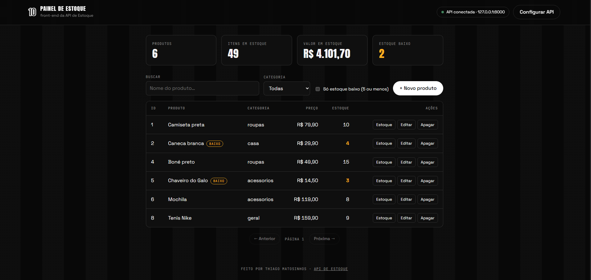

# 🖥️ Painel de Estoque

Painel web para a [API de Estoque](https://github.com/thiagomartinsmdev/estoque-api): cadastre, edite, apague e ajuste o estoque dos produtos, com resumo e alertas de estoque baixo. Feito com **HTML, CSS e JavaScript puro**, sem bibliotecas.



## Funcionalidades

- **Login com e-mail e senha** (token JWT da API), com criação do primeiro usuário pelo próprio painel
- Resumo do estoque: total de produtos, itens, valor em estoque e alertas
- Lista de produtos com busca por nome, filtro por categoria, filtro de estoque baixo e paginação
- Cadastro e edição de produtos, com validação dos campos
- Entrada e saída de estoque (a API bloqueia estoque negativo e o painel mostra o motivo)
- Exclusão com confirmação
- **Modo demonstração:** sem a API, o painel usa dados de exemplo guardados no navegador, então dá para testar online
- Layout responsivo (celular e computador), acessível e com tema escuro

## Tecnologias

HTML5 · CSS3 · JavaScript (ES2020) · Fetch API · API REST (FastAPI + PostgreSQL)

## Como rodar com a API

1. Suba a API de Estoque, que precisa estar com CORS habilitado (veja abaixo):

```bash
uvicorn app.main:app --reload
```

2. Abra a pasta do painel no VS Code e rode com a extensão **Live Server** (botão *Go Live*), ou pelo terminal:

```bash
python -m http.server 5500
```

3. Acesse **http://127.0.0.1:5500** e confira o selo verde **API conectada** no topo.
4. Faça login (ou crie o primeiro usuário, veja abaixo).

Se a API estiver em outro endereço, clique em **Configurar API** e informe a URL.

### CORS na API

Como o painel e a API ficam em endereços diferentes, a API precisa permitir o acesso do navegador. No `app/main.py` da API de Estoque:

```python
from fastapi.middleware.cors import CORSMiddleware

app.add_middleware(
    CORSMiddleware,
    allow_origins=["*"],   # em produção, liste só os endereços permitidos
    allow_methods=["*"],
    allow_headers=["*"],
)
```

## Login

O painel só mostra o estoque depois do login.

- **Primeira vez (API sem nenhum usuário):** a janela aparece como **Criar primeiro usuário**. Preencha nome, e-mail e senha (8 ou mais caracteres) duas vezes e clique em **Criar e entrar**: o painel cadastra e já entra.
- **Depois disso:** a janela aparece como **Entrar**, só com e-mail e senha.
- **No topo** aparece "Olá, (seu nome)" e o botão **Sair**.
- **Recarregar a página** mantém você logado (o token fica no `sessionStorage`, que é apagado quando você fecha a aba; nunca vai para o `localStorage`).
- **Login expirado ou inválido:** o painel limpa a tela, avisa "Sessão expirada. Entre novamente." e abre o login de novo.
- A janela de login não fecha com Esc. Se precisar trocar o endereço da API ou ir para o modo demo, use o botão **Configurar API** dentro dela.

Para cadastrar outras pessoas, use `POST /auth/registro` no `/docs` da API já logado (botão **Authorize**).

## Modo demonstração

Se a API não for encontrada, aparece o aviso amarelo e o painel passa a usar dados de exemplo salvos no `localStorage` do navegador. Nada é enviado para a internet. Clique em **Tentar conectar de novo** quando a API estiver ligada.

O modo demo também pede login, com um usuário fixo de exemplo:

| E-mail | Senha |
| :-- | :-- |
| `demo@painel.com` | `demo1234` |

Esses dados aparecem na própria janela de login. No modo demo não dá para criar usuários.

## Estrutura

```
index.html       # página e janelas (dialogs)
css/style.css    # visual (tema escuro, responsivo)
js/app.js        # lógica: login, API, modo demo, tabela, formulários
```

## Próximos passos

- [x] Login (JWT na API)
- [x] Gráfico de estoque por categoria
- [ ] Exportar a lista para CSV

---

Feito por **Thiago Matosinhos** · [GitHub](https://github.com/thiagomartinsmdev) · [LinkedIn](https://www.linkedin.com/in/thiago-filipe-b08586325/)
